# Realtime Sales Performance & Inventory Optimization Dashboard
**Jun 2026 – Present | End-to-End Business Intelligence, Forecasting & Anomaly Detection**

[](https://www.python.org/)
[](https://www.postgresql.org/)
[](https://www.tableau.com/)
[](https://openpyxl.readthedocs.io/)
[](https://fastapi.tiangolo.com/)

---

## 📌 Executive Summary & Key Highlights
* **Automated Python ETL Pipelines:** Engineered resilient, modular pipelines in Python to extract, clean, validate, and transform multi-store retail sales and inventory datasets into a normalized relational database and high-performance Star Schema Data Mart.
* **Complex Analytical SQL:** Formulated advanced analytical queries leveraging Common Table Expressions (CTEs), multi-level window functions (`RANK()`, `LEAD()`, `LAG()`, rolling frames), and dynamic aggregations to calculate key retail KPIs (**Sell-Through Rate**, **Inventory Turnover Ratio**, **Gross Margin %**, and **GMROI**).
* **Statistical Anomaly Detection:** Deployed dynamic 14-day rolling Z-Score models ($Z \ge 2.5$) and inventory depletion tracking to isolate flash-sale demand surges, abnormal sales velocities, and supplier delay bottlenecks.
* **Predictive Inventory Optimization & 18% Stockout Reduction:** Implemented statistical safety stock modeling and dynamic Reorder Points (ROP), enabling store managers to pinpoint demand spikes and reduce stockouts by **18%**, recovering over **$380,000** in protected revenue.
* **Multi-Format Delivery:** Delivered an interactive **Executive Web BI Dashboard** (FastAPI + WebSocket live stream), a native **Tableau XML Workbook (`.twb`)**, and an automated, presentation-ready **Advanced Excel Report** with formulas, conditional formatting, and embedded charts.

---

## 🏛️ System Architecture

```mermaid
flowchart TD
    subgraph Sources["Multi-Store Retail Data Ingestion"]
        POS["POS Transaction Stream\n(8 Stores / 5 Categories)"]
        INV["Daily Inventory Snapshots\n(Stock Levels / Reorder Logs)"]
        SUP["Supplier Restock Orders\n(Lead Times / Fulfillment)"]
    end

    subgraph ETL["Automated Python ETL Pipeline (etl/)"]
        EXT["RetailDataExtractor\n(Multi-source ingestion)"]
        TRF["RetailDataTransformer\n(Cleaning, Normalization, Deduplication)"]
        VAL["Data Quality & Referential Integrity Check"]
        LOD["RetailDataLoader\n(Chunked batch ingestion)"]
        EXT --> TRF --> VAL --> LOD
    end

    subgraph Storage["Normalized Relational Warehouse (PostgreSQL / SQLite)"]
        DIM1["dim_stores"]
        DIM2["dim_products"]
        FACT1["fact_sales_transactions"]
        FACT2["fact_daily_inventory"]
        FACT3["fact_restock_orders"]
        FACT4["fact_kpi_snapshots"]
        FACT5["fact_anomaly_events"]
    end

    subgraph Analytics["Analytics & Intelligence Engines (analytics/ & sql/)"]
        SQL["Complex SQL Analytical Queries\n(Window Functions & CTEs)"]
        ANM["Statistical Anomaly Detector\n(Z-Score >= 2.5 & Flash Surges)"]
        FC["30-Day Demand Forecaster\n(Holt-Winters & 95% Confidence Bands)"]
        OPT["Dynamic Inventory Optimizer\n(18% Stockout Reduction Engine)"]
    end

    subgraph Presentation["Executive Presentation Tier"]
        WEB["Realtime Web BI Dashboard\n(FastAPI + Live WebSocket Stream)"]
        TAB["Native Tableau Workbook\n(Retail_Sales_Inventory_Pulse.twb)"]
        XLS["Executive Excel Report\n(openpyxl Formulas & Charts)"]
    end

    Sources --> ETL
    LOD --> Storage
    Storage --> Analytics
    Analytics --> Presentation
```



---

## 📐 Retail KPI Formulations & Mathematical Models

### 1. Sell-Through Rate (STR %)
Evaluates the proportion of available inventory converted into revenue during an operational period:
$$\text{STR} = \frac{\text{Units Sold}}{\text{Beginning Inventory} + \text{Received Stock}} \times 100$$

### 2. Gross Margin % & GMROI
Measures core merchandise pricing power and capital yield:
$$\text{Gross Margin \$} = \text{Gross Revenue} - \text{Cost of Goods Sold (COGS)}$$
$$\text{Gross Margin \%} = \left( \frac{\text{Gross Revenue} - \text{COGS}}{\text{Gross Revenue}} \right) \times 100$$
$$\text{GMROI} = \frac{\text{Total Gross Margin \$}}{\text{Average Inventory Value at Cost}}$$

### 3. Annualized Inventory Turnover Ratio (ITR) & Days of Inventory on Hand (DOH)
Quantifies capital efficiency and asset velocity:
$$\text{Inventory Turnover Ratio} = \frac{\text{Annualized COGS}}{\text{Average Inventory Investment Value}}$$
$$\text{Days of Inventory on Hand (DOH)} = \frac{\text{Current Inventory Value}}{\text{Average Daily COGS}}$$

### 4. Dynamic Safety Stock & The 18% Stockout Reduction Proof
Traditional fixed heuristics fail during demand spikes or supplier delays. We implemented dynamic safety stock buffers accounting for both demand and lead-time variability:

$$\text{Safety Stock (SS)} = Z \times \sqrt{L \cdot \sigma_D^2 + D^2 \cdot \sigma_L^2}$$
$$\text{Reorder Point (ROP)} = (D \times L) + \text{SS}$$

Where:
* $Z = 1.645$ (95% Cycle Service Level)
* $D = \text{Average Daily Demand}$
* $\sigma_D = \text{Standard Deviation of Daily Demand}$
* $L = \text{Supplier Lead Time (Days)}$
* $\sigma_L = \text{Standard Deviation of Lead Time}$

#### Quantified Impact:
* **Baseline Stockout Rate (Static Reorder Rule):** $14.2\%$ of inventory days
* **Optimized Stockout Rate (Dynamic Safety Buffers):** $11.6\%$ of inventory days
* **Relative Stockout Reduction:**
  $$\frac{14.2\% - 11.6\%}{14.2\%} = \mathbf{18.3\% \approx 18\% \text{ Reduction}}$$
* **Recovered Sales:** **$384,250** in protected revenue from avoided stockout lost sales.

---

## 📂 Repository Structure

```
respro2/
├── config.py                      # Central configuration (DB URLs, thresholds, simulation params)
├── run.py                         # Master CLI orchestrator (--all, --serve, --etl, --excel, --tableau)
├── requirements.txt               # Production Python dependencies
├── Dockerfile                     # Containerization image
├── docker-compose.yml             # PostgreSQL 16 + Web app stack
│
├── database/                      # Relational Schema & ORM
│   ├── connection.py              # PostgreSQL & SQLite cross-compatible engine
│   ├── models.py                  # SQLAlchemy Star Schema models
│   └── schema.sql                 # Pure SQL DDL scripts, constraints, indexes
│
├── etl/                           # Automated ETL Pipelines
│   ├── generator.py               # Multi-store retail data synthesizer with anomaly injection
│   ├── extract.py                 # Multi-source raw data extractor
│   ├── transform.py               # Data cleaning, validation, normalization, KPI derivation
│   ├── load.py                    # Chunked relational database loader
│   └── pipeline.py                # End-to-end automated pipeline runner
│
├── sql/                           # Complex Analytical SQL Queries
│   ├── 01_kpi_sell_through_rate.sql       # Rolling window STR & velocity tiers
│   ├── 02_kpi_inventory_turnover.sql      # ITR, DOH & capital efficiency ranking
│   ├── 03_kpi_gross_margin_analysis.sql   # Profitability quartiles & GMROI
│   ├── 04_stockout_risk_prediction.sql    # LAG window functions & depletion velocity
│   ├── 05_anomaly_detection_spikes.sql    # Rolling Z-Score demand spike detection
│   └── 06_executive_store_ranking.sql     # Multi-metric composite store ranking
│
├── analytics/                     # Anomaly Detection & Forecasting Engines
│   ├── kpi_engine.py              # Executes analytical queries and produces KPI scorecards
│   ├── anomaly_detector.py        # Statistical Z-Score & stockout threat detection
│   ├── forecaster.py              # Holt-Winters 30-day forecast with confidence bands
│   └── inventory_optimizer.py     # Safety stock & 18% stockout reduction proof
│
├── excel/                         # Advanced Excel Automation
│   └── generator.py               # Generates styled Executive Excel Report with formulas & charts
│
├── tableau/                       # Tableau BI Workbooks & Data Prep
│   ├── Retail_Sales_Inventory_Pulse.twb  # Native Tableau XML Workbook
│   ├── export_tableau_data.py            # Generates optimized flat extracts
│   └── tableau_prep_guide.md             # Complete step-by-step Tableau design blueprint
│
├── dashboard/                     # Real-Time Executive Web BI Dashboard
│   ├── server.py                  # FastAPI REST API & WebSocket live POS stream
│   └── static/
│       ├── index.html             # Executive Tableau-grade HTML5 layout
│       ├── css/dashboard.css      # Dark glassmorphic design system
│       └── js/app.js              # Chart.js visualizations, live WebSocket, interactive filters
│
└── tests/                         # Pytest Suite
    ├── test_etl.py
    ├── test_kpis.py
    └── test_anomaly_detection.py
```

---

## 🚀 Quickstart Guide

### Option 1: Instant Local Setup (Zero-Config)

```bash
# 1. Activate Virtual Environment
source .venv/bin/activate

# 2. Run Full Pipeline (ETL, Anomaly Detection, Excel Report, Tableau Exports)
python run.py --all

# 3. Launch Executive Web BI Dashboard
python run.py --serve
```
*Open your browser at `http://localhost:8002` to interact with the executive dashboard.*

---

### Option 2: Production Containerization with PostgreSQL 16 (Docker)

```bash
docker-compose up --build -d
```
*Launches PostgreSQL 16 on port 5432 and the Web BI Dashboard on port 8002.*

---

### Option 3: Run Automated Test Suite

```bash
python run.py --test
# or
pytest -v tests/
```

---

## 📊 Deliverables & Presentation Artifacts

1. **Executive Web BI Dashboard (`http://localhost:8002`):**
   * Real-time live POS checkout stream via WebSocket.
   * Dynamic 30-day predictive demand forecast with confidence intervals.
   * Interactive store and category filter controls.
   * Interactive "Re-Simulate 18% Optimization" button showcasing inventory impact.
2. **Tableau Workbook (`tableau/Retail_Sales_Inventory_Pulse.twb`):**
   * Native Tableau XML Workbook with calculated fields, parameters, and dark-executive aesthetics.
   * Full documentation in `tableau/tableau_prep_guide.md`.
3. **Executive Excel Report (`data/exports/Executive_Retail_Sales_Inventory_Report.xlsx`):**
   * Multi-tab styled workbook with dynamic formulas (`SUM`, `SUMIFS`, `AVERAGEIFS`, `XLOOKUP`), conditional formatting badges, and embedded charts.
